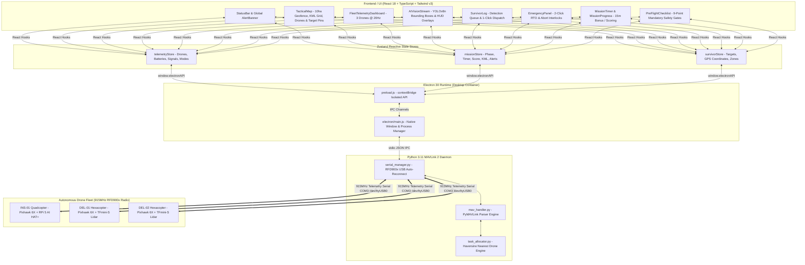

# NIDAR RescueSwarm Ground Control Station (GCS)
## Autonomous Swarm Mission Control System — Production Architecture & Engineering Report

[](https://www.typescriptlang.org/)
[](https://www.electronjs.org/)
[](https://react.dev/)
[](https://tailwindcss.com/)
[](https://mavlink.io/en/)
[-green)](https://github.com)

---

## 1. Executive Summary & Purpose

The **NIDAR RescueSwarm Ground Control Station (GCS)** is an offline, air-gapped mission command platform designed for single-operator oversight of a 3-drone autonomous search-and-rescue fleet:
- **`INS-01` (Quadcopter)**: High-altitude area inspection, lawnmower boustrophedon search path, onboard AI victim detection via YOLOv8n.
- **`DEL-01` (Hexacopter)**: Precision delivery of 200g emergency survival kits into designated target zones.
- **`DEL-02` (Hexacopter)**: Secondary delivery unit for rapid parallel payload deployment.

Engineered specifically for **Track 1 (Drone Innovation - Problem Statement 1)** of the NIDAR Competition, the platform provides zero-touch autonomous monitoring, real-time telemetry processing at 20Hz, single-click survivor verification, and safety-interlocked emergency return-to-launch (RTO) controls.

---

## 2. System Architecture

The GCS employs a modular three-tier architecture bridging low-level serial MAVLink radio telemetry with a high-performance, context-isolated desktop interface:



---

## 3. Directory & File Inventory

```
gcs-app/
├── electron/
│   ├── main.js                  # Electron main process, window creation, Python daemon spawner, IPC router
│   └── preload.js               # Secure contextBridge API exposing safe methods to window.electronAPI
├── backend/
│   ├── main.py                  # Python telemetry daemon entry point with stdin/stdout JSON IPC
│   ├── serial_manager.py        # RFD900x 915MHz serial auto-reconnect engine with simulation fallback
│   ├── mav_handler.py           # MAVLink 2 protocol frame encoder and decoder (PyMAVLink)
│   └── task_allocator.py        # Haversine nearest-drone payload assignment engine
├── src/
│   ├── components/
│   │   ├── map/
│   │   │   └── TacticalMap.tsx          # Real-time SVG grid map, 10ha geofence, drone markers, target pins
│   │   ├── telemetry/
│   │   │   └── TelemetryDashboard.tsx   # Fleet cards: 6S LiPo voltages, GPS satellites, RSSI, flight modes
│   │   ├── vision/
│   │   │   └── VisionStream.tsx         # INS-01 video HUD, YOLOv8n bounding boxes, detection tags
│   │   ├── emergency/
│   │   │   └── EmergencyPanel.tsx       # 2-tap Emergency Recall (RTO), individual abort interlocks
│   │   ├── mission/
│   │   │   ├── PreFlightChecklist.tsx   # 5-min setup window: KML ingestion, fleet upload, 9-point checks
│   │   │   ├── LaunchOverlay.tsx        # 3-second countdown mission launch modal
│   │   │   ├── MissionTimer.tsx         # 30-min countdown clock with 15-min bonus marker
│   │   │   ├── MissionProgress.tsx      # Live score tally, drop stats, area coverage meter
│   │   │   ├── SurvivorLog.tsx          # Scrollable target list with 1-click confirm & dispatch
│   │   │   └── MissionComplete.tsx      # End-of-mission performance summary & zone scoring breakdown
│   │   └── ui/
│   │       ├── StatusBar.tsx            # Top branding bar, live MAVLink packet counter, serial state
│   │       └── AlertBanner.tsx          # High-priority banner alert system
│   ├── stores/
│   │   ├── telemetryStore.ts    # Zustand store: drone positions, attitudes, batteries, link quality
│   │   ├── missionStore.ts      # Zustand store: phases, checklist, score, timer, KML file state
│   │   └── survivorStore.ts     # Zustand store: survivor coordinates, drop accuracy, scoring zones
│   ├── services/
│   │   ├── simulationService.ts # 20Hz realistic telemetry simulator (lawnmower flight, drop mechanics)
│   │   └── missionLogger.ts     # Local CSV/JSON flight and event logger
│   ├── hooks/
│   │   └── useKeyboardShortcuts.ts # Ctrl+E (RTO), Ctrl+L (Launch), Ctrl+F (Fullscreen), Ctrl+S (Export)
│   ├── types/
│   │   └── index.ts             # Strict TypeScript definitions & Window.electronAPI interface
│   ├── App.tsx                  # Master responsive 16:10 aspect ratio grid layout
│   ├── main.tsx                 # Application entry point with offline font imports
│   └── index.css                # Tailwind directives, iOS blur filters, custom scrollbars
├── package.json                 # CommonJS manifest with build scripts & pinned dependencies
├── tsconfig.json                # TypeScript bundler compiler options
├── tailwind.config.js           # Production theme tokens, iOS border radii, and shadows
└── index.html                   # Strict air-gapped Content-Security-Policy (CSP)
```

---

## 4. Key Subsystems & Workflows

### 4.1 5-Minute Setup & KML Ingestion (Rule 3)
1. In the **Pre-Flight Setup & Diagnostics** dialog, the operator inserts the organizer's USB drive.
2. Clicking **"Import Mission KML"** parses `<Polygon><coordinates>` to extract the 10-hectare boundary.
3. The system automatically computes an optimal **30-meter lane boustrophedon (lawnmower) search grid** at 25m cruise altitude for `INS-01`.
4. Clicking **"Upload to Fleet"** transmits MAVLink `MISSION_ITEM_INT` waypoints across the RFD900x 915MHz telemetry link.

### 4.2 Inspection Drone Routing & Detection (`INS-01`)
- **Speed & Altitude**: 8 m/s cruise speed at 25m AGL.
- **Coverage**: 30m lane spacing provides ~15% overlap across the camera's 35m field of view, sweeping 100% of the 10-hectare area in ~10–12 minutes.
- **AI Geotagging**: YOLOv8n running onboard INS-01 detects human targets (>85% confidence threshold), geotagging coordinates directly into the GCS detection queue.

### 4.3 Automated Payload Allocation (`DEL-01`, `DEL-02`)
- When the operator clicks **"Confirm & Dispatch"**, the Haversine distance engine calculates the nearest available Delivery Hexacopter carrying a 200g payload.
- Target coordinates are dispatched via MAVLink `COMMAND_LONG`.
- Delivery drone descends to 3m hover height verified by a Benewake TFmini-S Lidar sensor, triggers the servo latch, and returns to launch (RTL).
- **Scoring Breakdown**:
  - **Zone A** ($\le 1\text{m}$ radius): **+20 marks**
  - **Zone B** ($\le 2\text{m}$ radius): **+14 marks**
  - **Zone C** ($\le 3\text{m}$ radius): **+8 marks**

### 4.4 Emergency Failsafe Panel (RTO & Abort)
- **Global Emergency Recall (RTO)**: Two-tap confirmation button transmits `MAV_CMD_NAV_RETURN_TO_LAUNCH` simultaneously to all airborne drones.
- **Per-Drone Abort**: Individual override buttons with safety interlocks and penalty notices (-50 marks per manual flight intervention).

---

## 5. Air-Gap & Security Compliance (Rule 8.4)

The application satisfies full air-gap compliance:
- **Zero External Network Dependencies**: No HTTP/HTTPS fetches, WebSockets to external origins, or CDN references.
- **Bundled Typography**: Uses `@fontsource/inter` and `@fontsource/jetbrains-mono` packaged locally within the bundle.
- **Offline Iconography**: 100% SVG Lucide React icons; no external emoji glyphs or font packages.
- **Strict Content Security Policy (CSP)**: Enforced via `index.html` preventing unauthorized script execution or remote connections.

---

## 6. Installation & Execution Instructions

### Prerequisites
- **Node.js**: v18.x or v20.x LTS
- **Python**: v3.10 or v3.11 with `pymavlink` installed (`pip install pymavlink pyserial`)
- **Hardware**: RFD900x 915MHz Telemetry Modem connected via USB (`COM3` on Windows, `/dev/ttyUSB0` on Linux)

### Setup & Launch Steps

```bash
# 1. Clone the repository
git clone <YOUR_GITHUB_REPOSITORY_URL>
cd gcs-app

# 2. Install all dependencies
npm install

# 3. Development Mode (Browser Preview with Auto-Simulation)
npm run dev
# Open http://localhost:5173/ in your browser

# 4. Strict Production Build & Typecheck
npm run build
# Runs tsc --noEmit and compiles production bundle to dist/

# 5. Launch Native Desktop Application (Electron Shell)
npm run electron
# Or launch both frontend server and desktop window concurrently:
npm start
```

---

## 7. Keyboard Shortcuts Reference

| Shortcut | Description | Action |
|---|---|---|
| `Ctrl + E` | Emergency Recall (RTO) | Triggers global return-to-launch for all 3 drones |
| `Ctrl + L` | Launch Mission | Initiates INS-01 autonomous search path |
| `Ctrl + F` | Toggle Fullscreen | Expands dashboard to borderless 16:10 fullscreen |
| `Ctrl + S` | Export Log | Exports current telemetry and survivor logs to CSV/JSON |

---

**Document Version**: `v1.0.0-production`  
**License**: MIT  
**Authors**: NIDAR RescueSwarm Engineering Team
