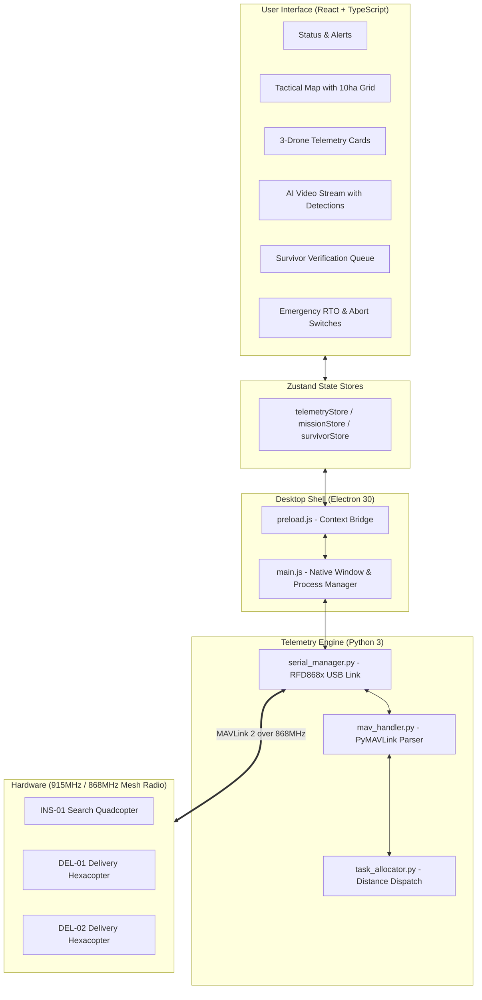

# Adrods_X RescueSwarm — Ground Control Station (GCS)

A desktop Ground Control Station built by **Team Adrods_X** for Track 1 (Drone Innovation) of the Autonomous Search & Rescue Challenge. It lets one operator supervise a three-drone team working across a 10-hectare search grid without relying on any internet connection or cloud service.

---

## The Fleet Setup

Our system coordinates three drones with distinct roles:

1. **`INS-01` (Inspection Quadcopter)**
   - Flies an autonomous back-and-forth (lawnmower) path at 25 m altitude and 8 m/s groundspeed.
   - Carries a Raspberry Pi 5 with an AI HAT+ running YOLOv8n to spot people on the ground and geotag their GPS coordinates.
2. **`DEL-01` (Delivery Hexacopter)**
   - Loiters on standby until a target is verified.
   - Carries a 200 g first-aid payload kit, flies to the survivor, descends to 3 m using a TFmini-S lidar, and releases the payload via a servo mechanism.
3. **`DEL-02` (Delivery Hexacopter)**
   - Operates in parallel with `DEL-01` to deliver second kits or service adjacent targets simultaneously.

All communication travels over a 915 MHz RFD900x serial radio link using standard MAVLink 2 packets.

---

## How the Pieces Connect

The system is split into three main layers: a Python telemetry backend, an Electron container, and a React frontend.



---

## Mission Workflow & Competition Rules

### 1. Pre-Flight Setup (5-Minute Window)
When the competition officials hand over the USB drive with the site boundary:
- Plug in the drive and click **Import Mission KML**.
- The app parses the polygon coordinates and automatically lays out a 30-meter lane lawnmower sweep covering the 10 hectares.
- Click **Upload to Fleet** to transmit the mission waypoints to the drones via MAVLink `MISSION_ITEM_INT`.
- Work through the 9-point safety checklist (voltage check, GPS lock, serial handshake) before arming.

### 2. Autonomous Search & Detection
- Hit **Launch Mission** (or press `Ctrl+L`). A 3-second countdown initiates the sweep.
- As `INS-01` sweeps the lanes, the onboard model flags human targets with >85% confidence.
- Each detection pops up on the operator's dashboard with an audible ping and drops a numbered pin on the tactical map.

### 3. Payload Delivery & Accuracy Scoring
- The operator reviews the snapshot and clicks **Confirm & Dispatch**.
- The backend runs a quick Haversine calculation to pick whichever delivery drone is closest and still has a payload.
- The delivery drone flies to the coordinates, matches height at 3 meters via lidar, drops the kit, and returns to launch (RTL).
- Points depend on drop precision:
  - **Zone A** (within 1 m): **20 pts**
  - **Zone B** (1 to 2 m): **14 pts**
  - **Zone C** (2 to 3 m): **8 pts**
  - Target: complete under 15 minutes for the **+50 mark bonus**.

### 4. Emergency Controls & Safety Interlocks
- **Global Emergency Recall (RTO)**: A two-step confirmed click sends `MAV_CMD_NAV_RETURN_TO_LAUNCH` across all drones immediately.
- **Per-Drone Abort**: Individual drones can be commanded down. Since manual interference costs **-50 marks**, these buttons include confirmation interlocks and warnings.

---

## Air-Gap & Security Design

Per Rule 8.4, the ground station must work without any network connection:
- All assets (fonts, icons, stylesheets) are bundled locally — no calls to external CDNs.
- Typography uses Inter and JetBrains Mono loaded from local files.
- Tactical map runs on local SVG grid coordinates and bundled MBTiles; no external map servers.
- A strict Content Security Policy blocks outbound socket or HTTP traffic.

---

## File Structure

```
gcs-app/
├── electron/
│   ├── main.js                  # Window management and Python daemon lifecycle
│   └── preload.js               # Safe contextBridge IPC wrapper
├── backend/
│   ├── main.py                  # Telemetry daemon with JSON stdin/stdout IPC
│   ├── serial_manager.py        # Serial port auto-reconnect and fallback simulation
│   ├── mav_handler.py           # MAVLink frame encoding/decoding via PyMAVLink
│   └── task_allocator.py        # Nearest-drone assignment logic
├── src/
│   ├── components/
│   │   ├── map/TacticalMap.tsx          # Real-time tactical grid, geofence, and pins
│   │   ├── telemetry/TelemetryDashboard.tsx # 3-drone cards (voltage, GPS, RSSI)
│   │   ├── vision/VisionStream.tsx      # Video HUD and detection bounding boxes
│   │   ├── emergency/EmergencyPanel.tsx # RTO recall and per-drone aborts
│   │   ├── mission/PreFlightChecklist.tsx # KML import, fleet upload, pre-flight checks
│   │   ├── mission/LaunchOverlay.tsx    # 3-second launch countdown modal
│   │   ├── mission/MissionTimer.tsx     # 30-min timer with 15-min bonus marker
│   │   ├── mission/MissionProgress.tsx  # Score, drop counts, coverage percentage
│   │   ├── mission/SurvivorLog.tsx      # Target verification list and dispatch button
│   │   └── ui/StatusBar.tsx             # Header bar with serial link and packet counters
│   ├── stores/                  # Zustand stores for telemetry, mission, and survivors
│   ├── services/simulationService.ts # 20Hz physics simulation for offline testing
│   ├── App.tsx                  # 16:10 tactical layout
│   └── main.tsx                 # React application entry point
├── package.json
└── tsconfig.json
```

---

## How to Run

### Development Mode (with Simulation)
If you don't have the RFD900x radio plugged in, the app automatically runs an internal 20 Hz simulation with drone paths, battery drain, and random survivor detections.

```bash
cd gcs-app
npm install
npm run dev
# Open http://localhost:5173
```

### Running the Desktop App
```bash
# Compile and open in Electron
npm run electron
```

### Building the Standalone Executable
```bash
# Creates an unpacked .exe in release/win-unpacked/
npm run package
```

You can then run `release/win-unpacked/Adrods_X RescueSwarm GCS.exe` directly on Windows without Node or Python installed.

---

## Keyboard Shortcuts

- `Ctrl + E`: Trigger Emergency Return to Launch (RTO) for all drones
- `Ctrl + L`: Launch search mission
- `Ctrl + F`: Toggle fullscreen mode
- `Ctrl + S`: Export flight logs to CSV

---

**Built by Team Adrods_X** for the Autonomous Search & Rescue Challenge.
